# Cyber Support Navigator (HacktoberFestCyberSafe)

A helper for elderly and non-technical people that answers three questions:

1. **"Is this message a scam?"** Paste or forward an SMS, email, or WhatsApp message.
2. **"Is this happening to me right now?"** Someone is on the phone asking for an OTP or telling you to install an app. The navigator tells you to stop and what to say.
3. **"I already fell for it. What now?"** Exactly who to call (1930, your bank), what to report, and in what order. Then it follows up until you are safe, and brings in a human if you go quiet.

## How the three sponsor tools are used

| Tool | Job |
|---|---|
| **Gemma on Jarvislabs** | Understands the message and explains the risk in plain English or Hindi, grounded in a curated directory of official Indian helplines. Runs on Jarvislabs, not on the person's phone. |
| **Temporal** | Runs the follow-up: sends the action plan, schedules check-ins, retries failed notifications, escalates unanswered cases to a human coordinator. |
| **Kepler** | The ops team's tool for inspecting the deployed service and investigating outages (see `docs/KEPLER_RUNBOOK.md`). |

## Run it locally

```sh
./scripts/dev.sh          # Temporal dev server, API, worker, web
```

Or by hand:

```sh
temporal server start-dev                       # UI: http://localhost:8233
cd backend && uv sync && uv run uvicorn app.main:app --reload --port 8000
cd backend && uv run python -m app.worker
cd web && bun install && bun run dev            # http://localhost:5173
```

Requirements, secrets and all settings: [`docs/SETUP.md`](docs/SETUP.md). Python pins are in `backend/requirements.txt` (exported from `uv.lock`).

API reference: [`docs/API.md`](docs/API.md).

## Screenshots

| | | |
|---|---|---|
| 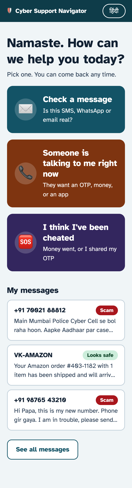 Home | 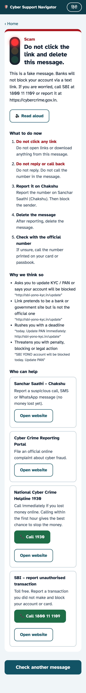 Scam check (Gemma 4) | 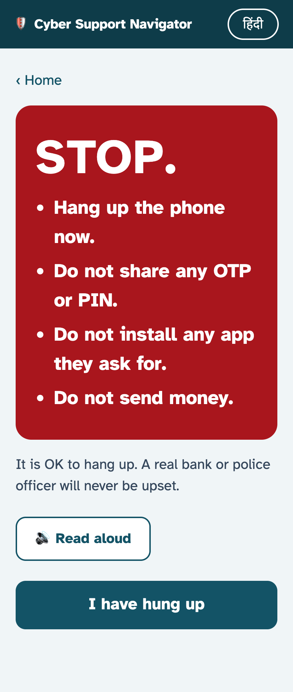 Happening now |
| 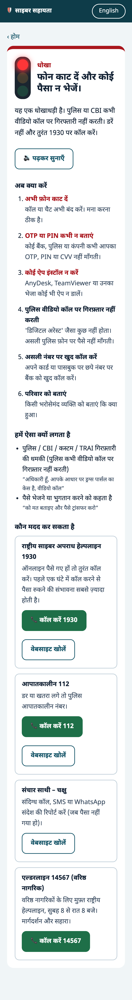 Hindi "digital arrest" | 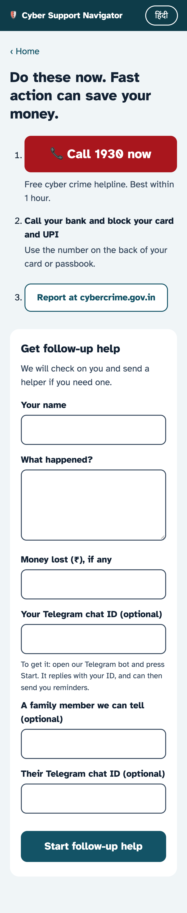 I've been cheated | 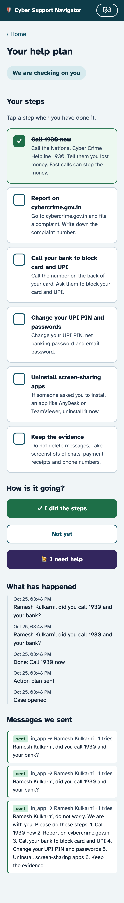 Follow-up case |
| 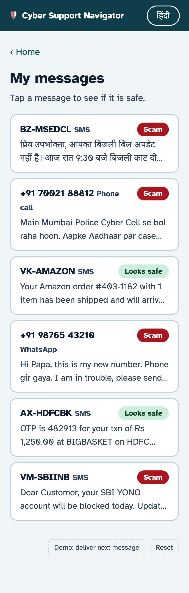 Simulated inbox | 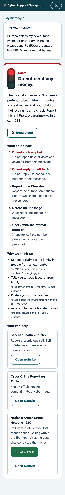 Message detail |  हिंदी |

Staff screens:

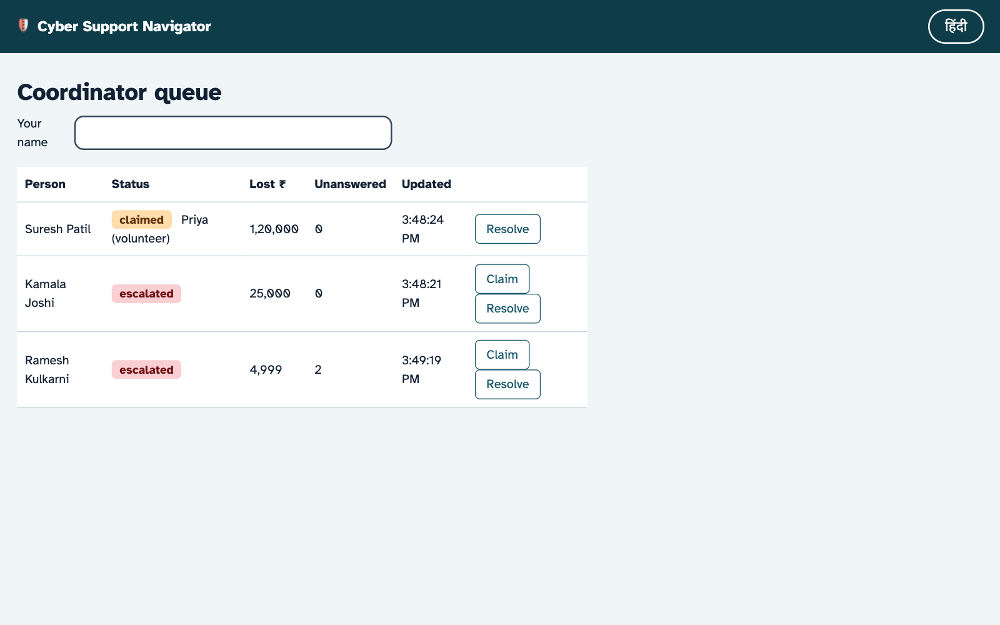
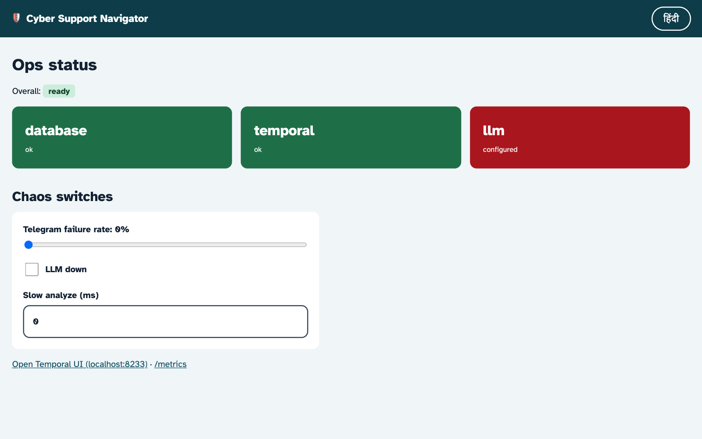
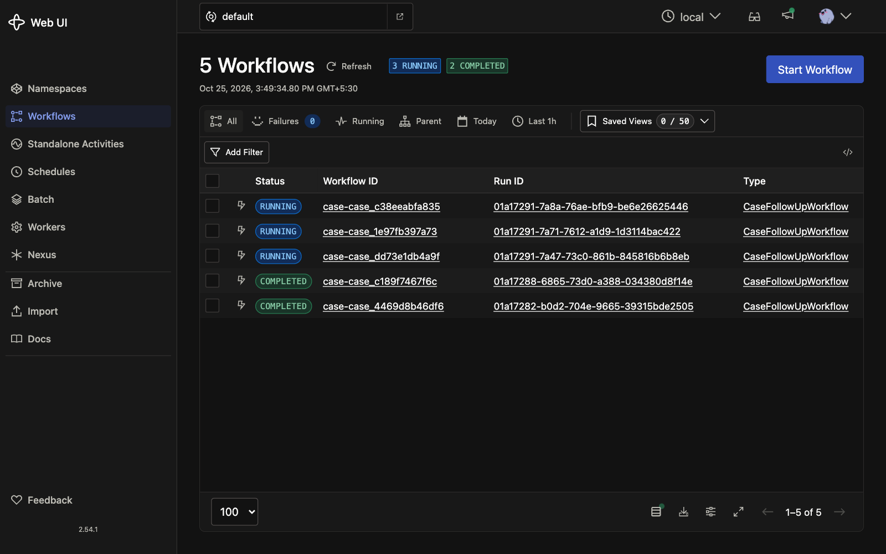
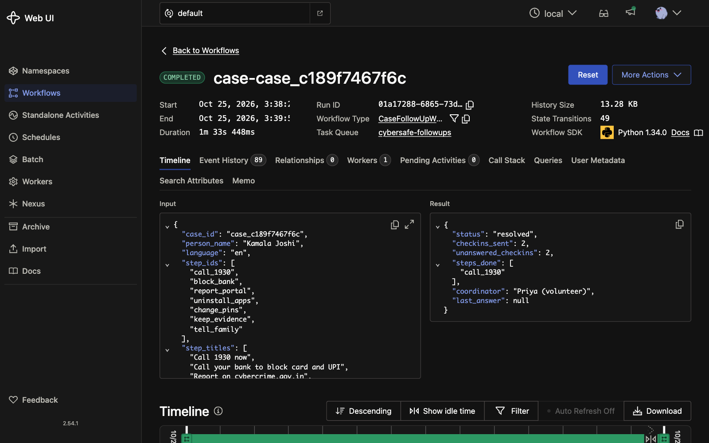
