# Cyber Support Navigator (HacktoberFestCyberSafe)

A helper for elderly and non-technical people that answers three questions:

1. **"Is this message a scam?"** Paste or forward an SMS, email, or WhatsApp message.
2. **"Is this happening to me right now?"** Someone is on the phone asking for an OTP or telling you to install an app. The navigator tells you to stop and what to say.
3. **"I already fell for it. What now?"** Exactly who to call (1930, your bank), what to report, and in what order. Then it checks on you until you confirm the checklist is done, and puts your case in a queue for a volunteer helper if you ask for help or go quiet.

## How the three sponsor tools are used

| Tool | Job |
|---|---|
| **Gemma on Jarvislabs** | Understands the message and explains the risk in plain English or Hindi, grounded in a curated directory of official Indian helplines. Runs on Jarvislabs, not on the person's phone. |
| **Temporal** | Runs the follow-up: sends the action plan, schedules check-ins, retries failed notifications, escalates unanswered cases to a human coordinator. |
| **Kepler** | The ops team's tool for inspecting the deployed service and investigating outages (see `docs/KEPLER_RUNBOOK.md`). |

## Run it locally

```sh
./scripts/dev.sh          # Temporal dev server, API, worker, web
```

`./scripts/dev.sh` is the supported way. To start the pieces by hand, open **four terminals, each at the repository root**:

```sh
# terminal 1
temporal server start-dev                       # UI: http://localhost:8233
# terminal 2
(cd backend && uv sync && uv run uvicorn app.main:app --reload --port 8000)
# terminal 3
(cd backend && uv run python -m app.worker)
# terminal 4
(cd web && bun install && bun run dev)          # http://localhost:5173
```

### Staff token

The coordinator queue (`/coordinator`) and ops page (`/ops`) are for volunteers, not the public. Set
`STAFF_TOKEN` to a long random secret before starting the API; those pages ask for it once per browser tab
and send it as `X-Staff-Token`. If `STAFF_TOKEN` is unset (local development) the endpoints are open, the API
logs a warning and `/readyz` shows `"staff_auth": "disabled"`. `ops/docker-compose.yml` refuses to start
without it. There are no user accounts: a person's own case is reachable by its unguessable link.

Requirements, secrets and all settings: [`docs/SETUP.md`](docs/SETUP.md). Python dependencies: [`requirements.txt`](requirements.txt) (`pip install -r requirements.txt`).

API reference: [`docs/API.md`](docs/API.md). Demo script: [`docs/DEMO.md`](docs/DEMO.md).
Kepler outage drills: [`docs/KEPLER_DRILLS.md`](docs/KEPLER_DRILLS.md). Demo video: [`docs/video/README.md`](docs/video/README.md).
Contributing: [`CONTRIBUTING.md`](CONTRIBUTING.md). Security: [`SECURITY.md`](SECURITY.md). License: [MIT](LICENSE).

## Privacy: what the code actually does

- **Message checks.** The pasted text is checked by our rules on the server. If the AI is configured, the text
  (first 4,000 characters) is also sent to the Gemma model on Jarvislabs. Digits (OTPs, phone, account and
  card numbers) are replaced with `[number]` first; names and other words are not removed. Message text is not
  written to our logs. Checked messages are not stored, except the sample messages of the practice inbox.
- **Cases.** Name, description, amount, Telegram ids and the analysis are stored in SQLite and in the Temporal
  workflow history. There is no automatic deletion yet; an operator must delete old data by hand.
- **Help.** "I need help" or two unanswered check-ins put the case in the coordinator queue. A volunteer sees it
  there (and on Telegram if configured); we cannot promise a call. Analysis results never open a case by themselves.
- **Practice inbox.** The inbox shows scripted sample messages. The app does not read anyone's phone.

## Background

- [`IDEA.md`](IDEA.md): the original idea from the repository owner.
- [`docs/PITCH.md`](docs/PITCH.md): the pitch and scope script. It describes the full vision, including planned
  features that are **not implemented** (for example Marathi, chatbot forwarding, low-confidence hand-off to a
  human, and short retention of raw messages). The privacy section above describes what the code does today.

## Screenshots

### Mobile (412 × 915)

| | | | |
|---|---|---|---|
| 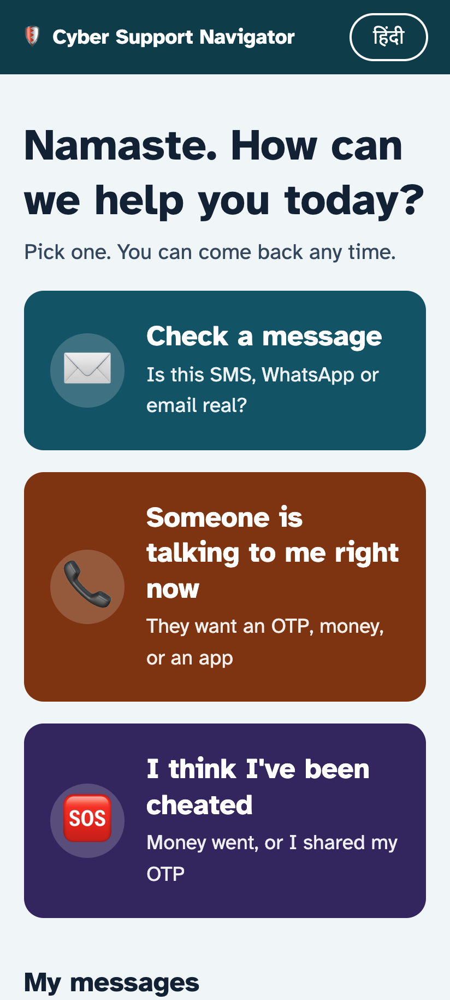 Home | 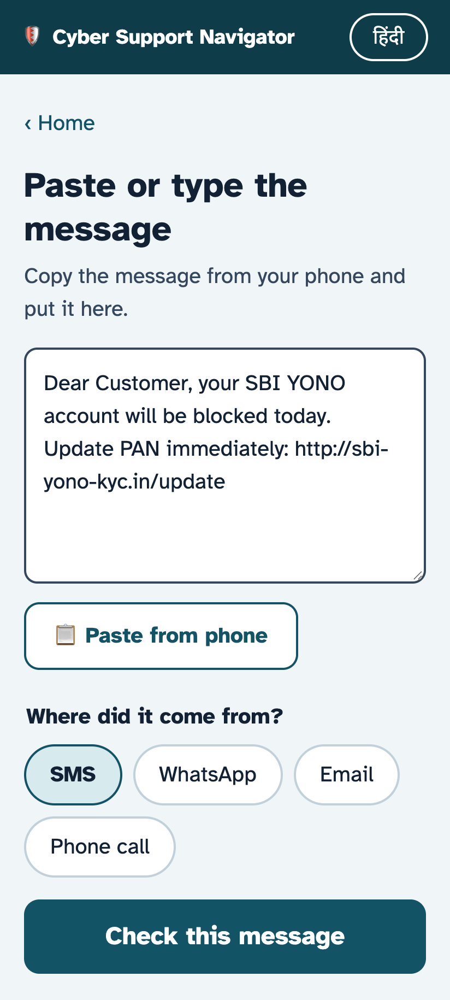 Check a message | 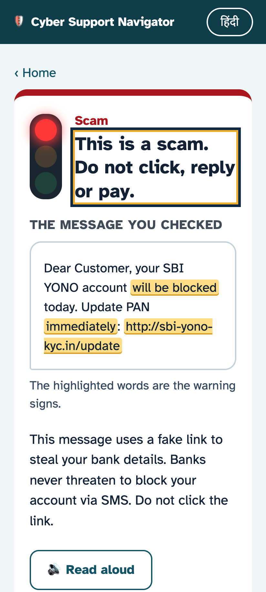 Scam result (Gemma 4) | 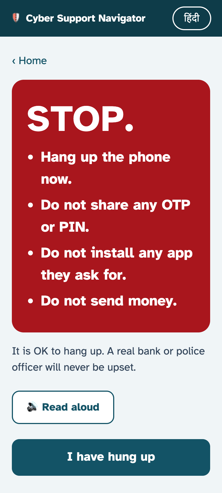 Happening now |
| 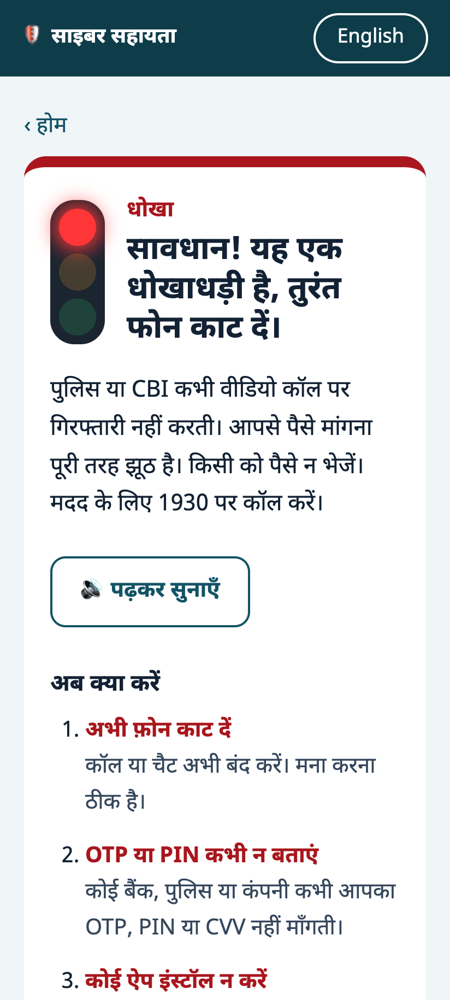 Hindi "digital arrest" | 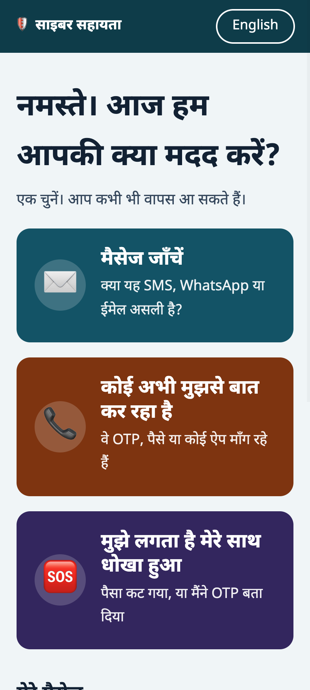 हिंदी home | 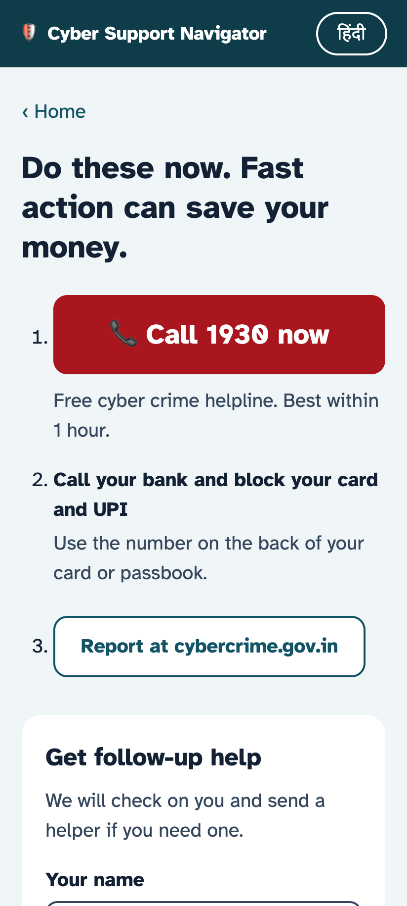 I've been cheated | 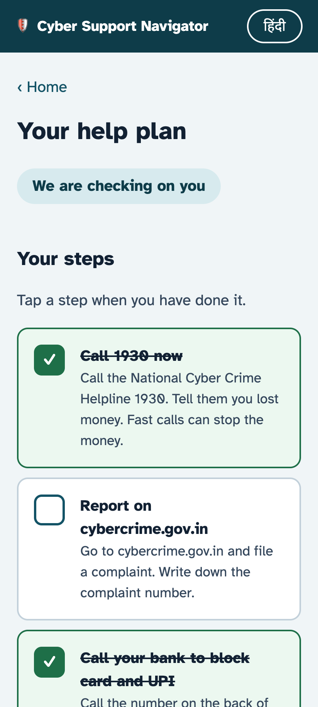 Help plan |
| 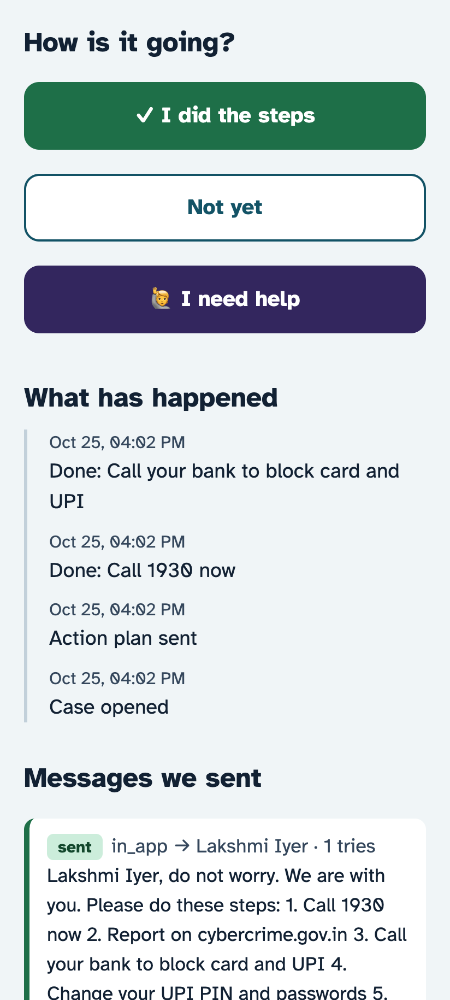 Check-in | 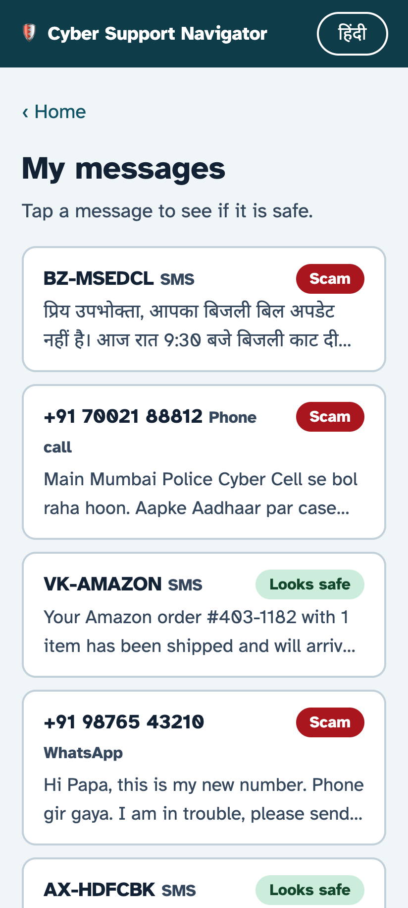 Practice inbox | 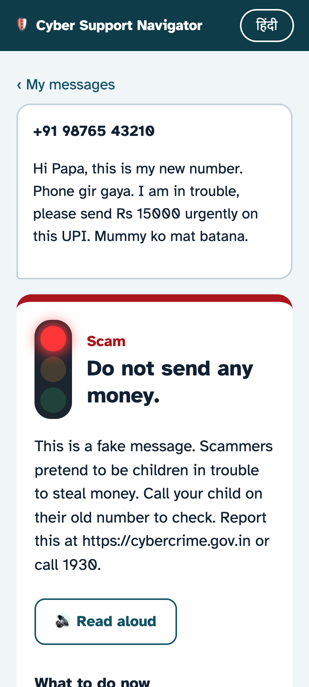 Message verdict | |

### Desktop (1440 × 810)

| | |
|---|---|
| 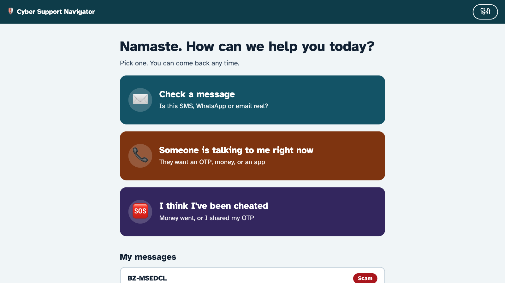 Home | 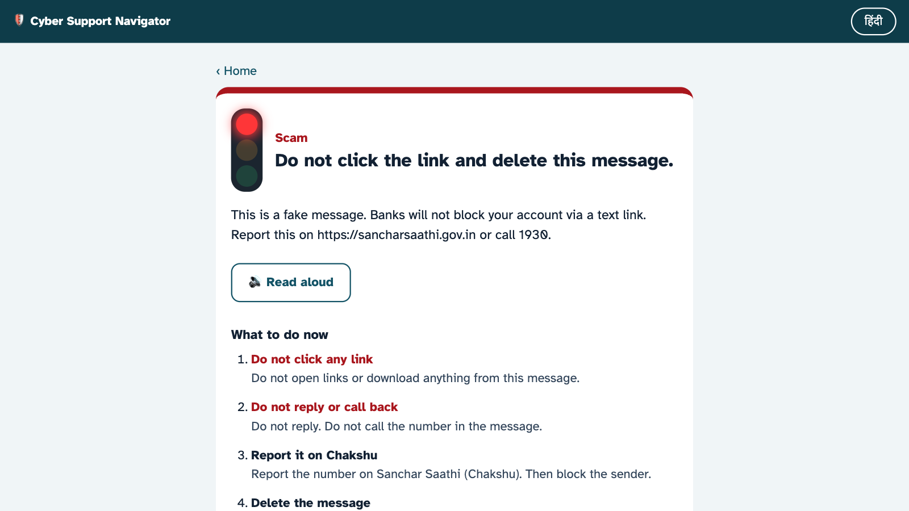 Scam result |
| 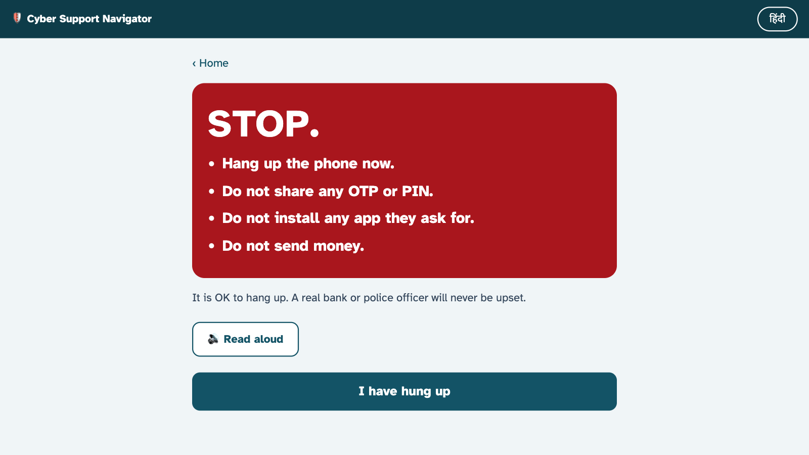 Happening now | 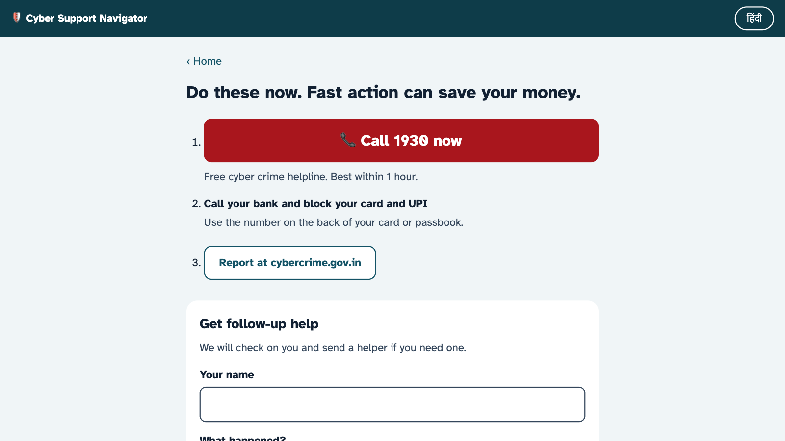 I've been cheated |
| 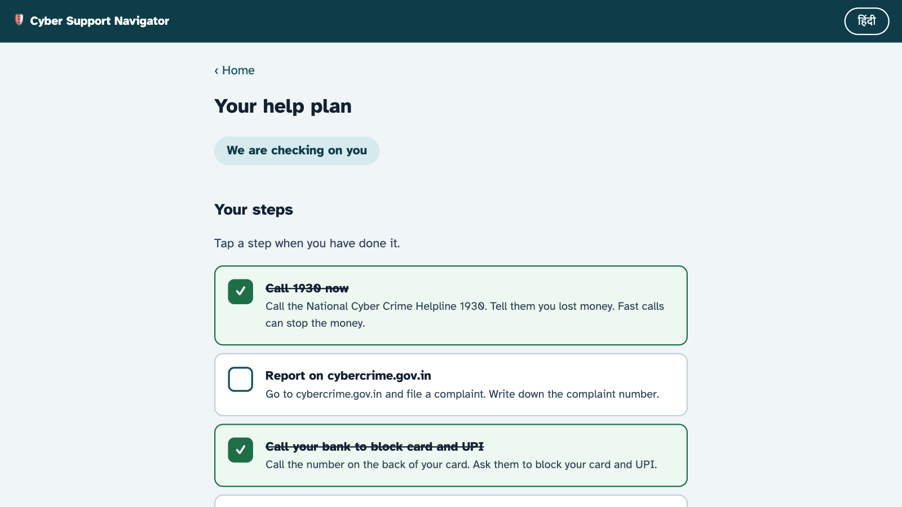 Help plan | 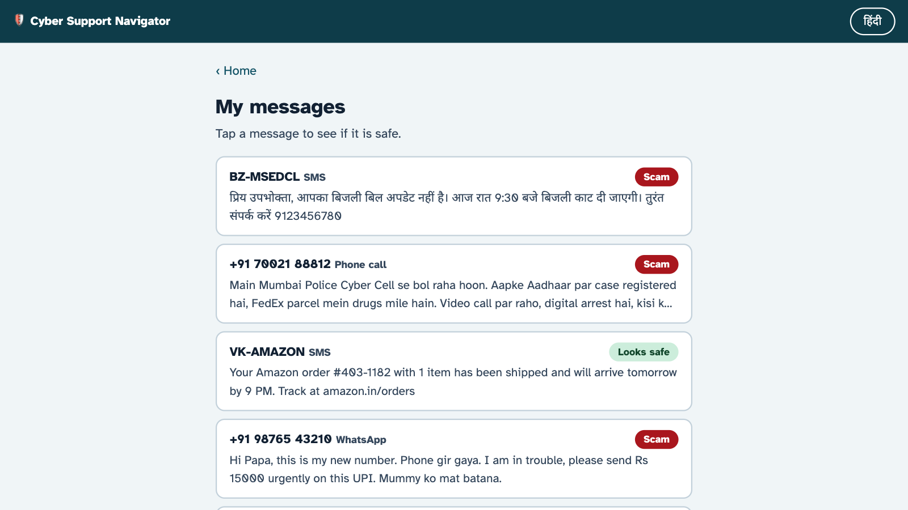 Practice inbox |
|  Coordinator queue | 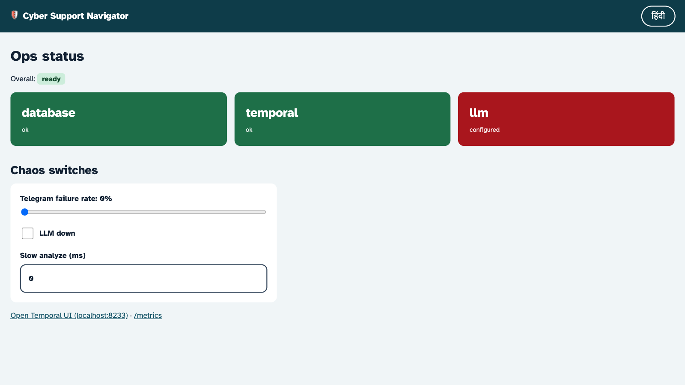 Ops status and chaos switches |
| 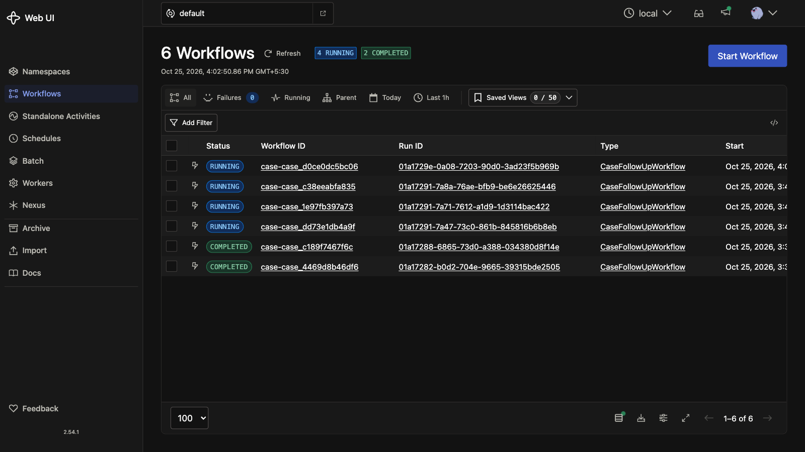 Temporal: case workflows | 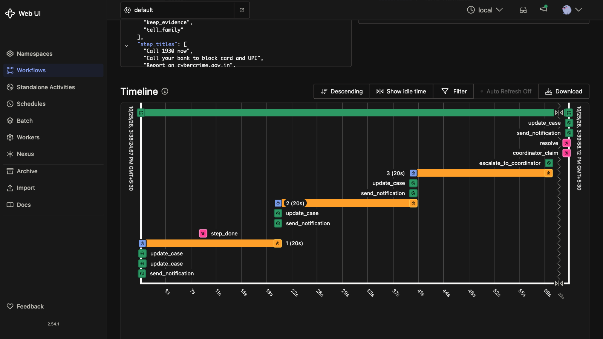 Temporal: escalation and recovery |

Full-length page captures are in [`docs/screenshots/full`](docs/screenshots/full).
