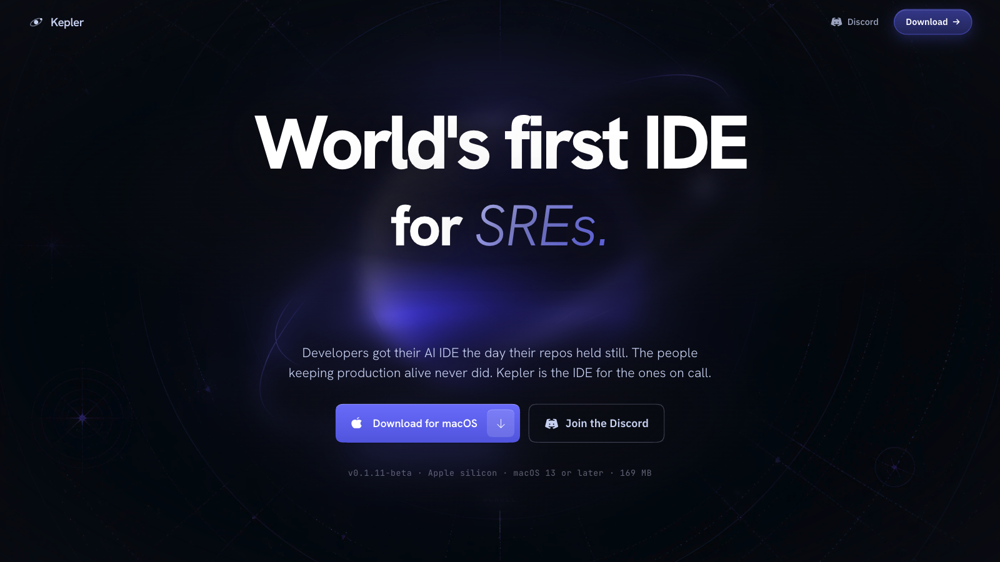
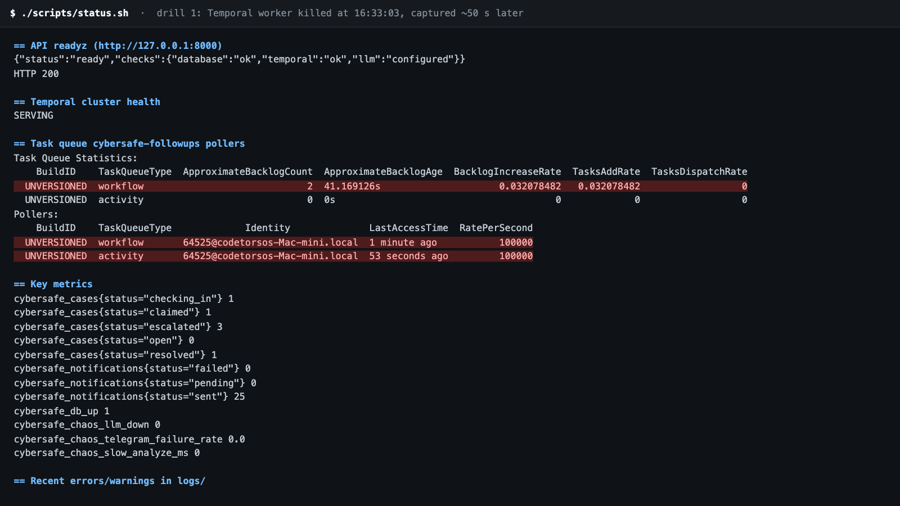
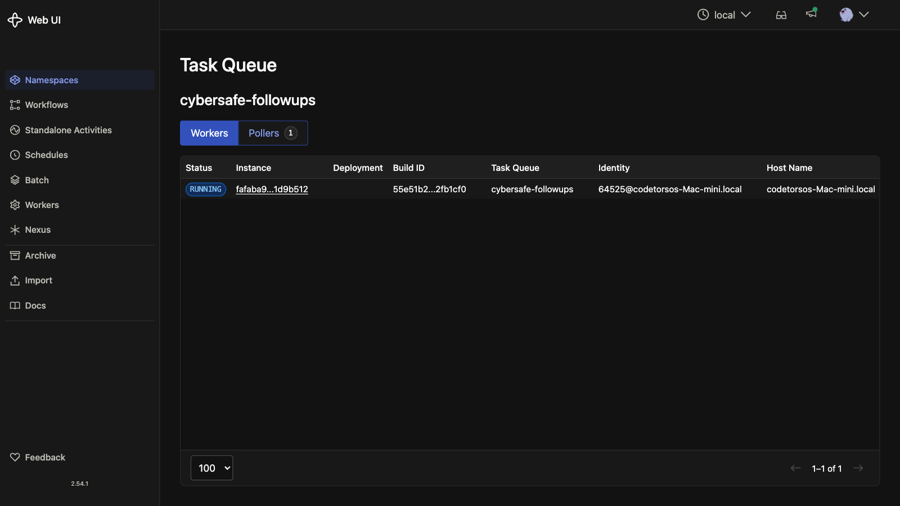
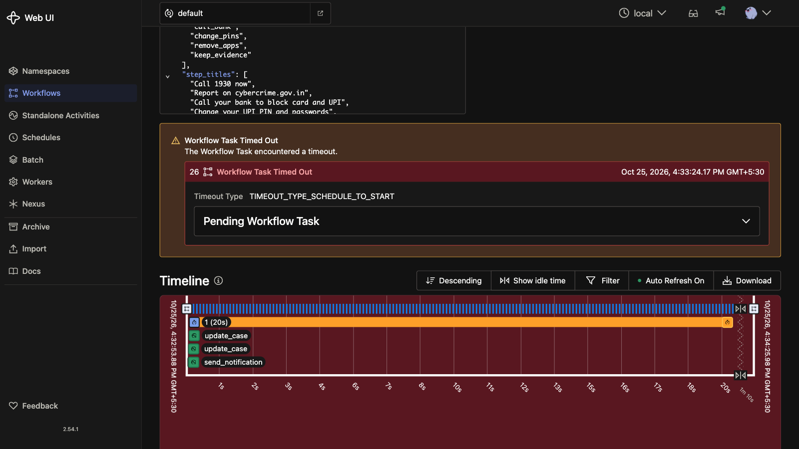
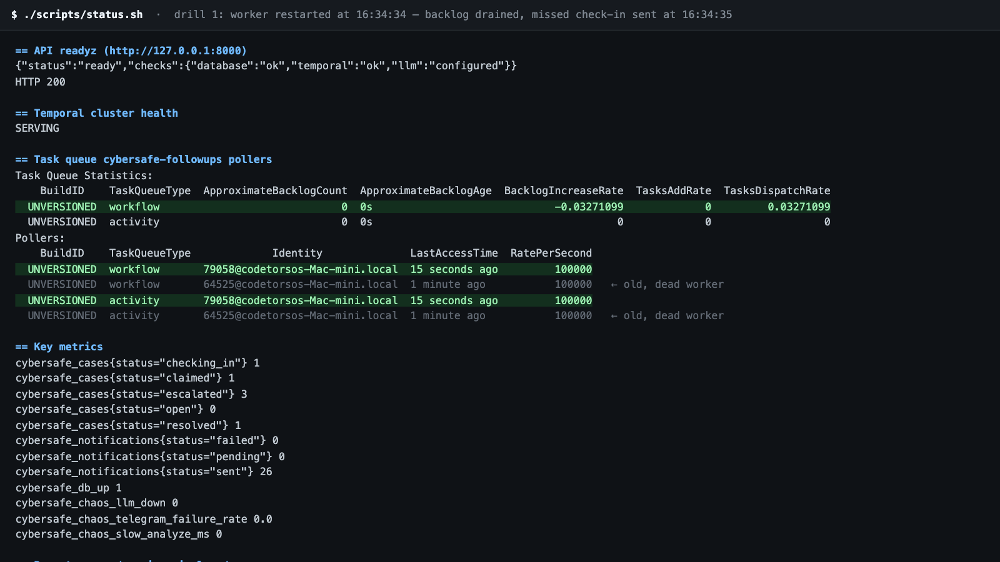
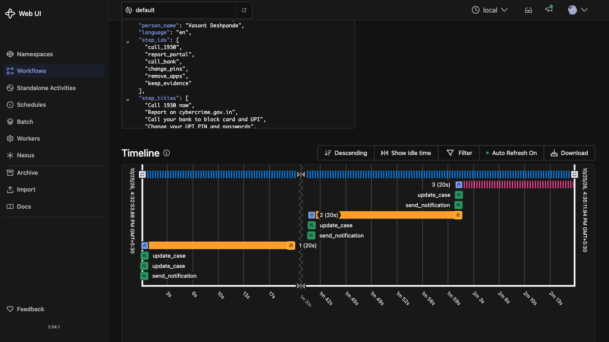
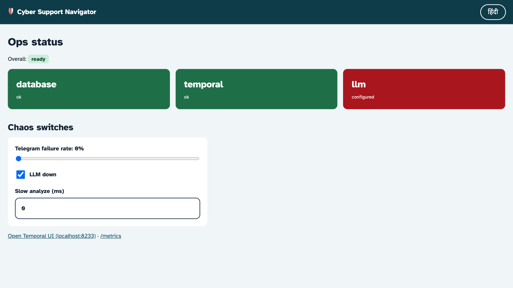
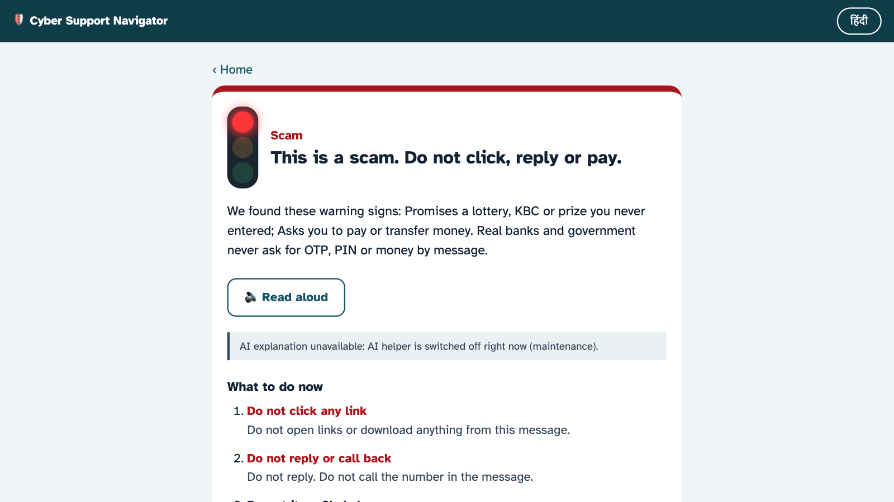

# Kepler outage drills (recorded 25 Oct 2026)

[Kepler](https://trykepler.rubixkube.ai/) is the ops team's tool. It is a desktop app the on-call person
uses to investigate the running service. Our code never calls Kepler. These drills break the
live stack on purpose and record what Kepler is pointed at: readiness, metrics, JSON logs and
Temporal. The full symptom table is in [`KEPLER_RUNBOOK.md`](KEPLER_RUNBOOK.md).

> The screenshots below are the signals captured during the drills (terminal, Temporal UI, our ops
> page). Screenshots of the Kepler chat window itself still need to be taken at the desk: the
> recording session had no screen access to the Kepler app.

## Drill 1: the follow-up worker dies

**Break it:** a case is open for Vasant Deshpande; the Temporal worker for this checkout is killed (`kill -9`) at 16:33:03.

**Ask Kepler:** *"Cases have stopped getting check-ins. Investigate the follow-up pipeline and tell me the root cause."*

**What it finds** (`./scripts/status.sh`, 50 s later):

- Workflow task backlog on `cybersafe-followups` is growing (2 tasks, 41 s old); the only poller was last seen a minute ago.
- `/readyz` still says **ready**: it checks the database and the Temporal frontend, not the worker. This gap was found by this drill and is being fixed (worker poller check in `/readyz` and `/metrics`).

Temporal's Workers tab is a trap here: it still lists the dead worker as `RUNNING` because the registration has not expired. Trust the backlog and poller age instead.

The case workflow is `RUNNING` but nothing moves: the check-in timer fired, and no worker picked up the task.

**Fix:** restart the worker (`cd backend && uv run python -m app.worker`). At 16:34:34 the new worker (pid 79058) starts polling, the backlog drains to 0, and the check-in that was due during the outage goes out at 16:34:35.

Nothing was lost: Temporal replayed the workflow from its event history and carried on.

## Drill 2: the AI model goes down

**Break it:** `./scripts/chaos.sh llm down`.

**Ask Kepler:** *"Users say the scam checker gives less detailed answers. What changed?"*

**What it finds:** the ops page and `/metrics` show the `LLM down` switch on (`cybersafe_chaos_llm_down 1`).

Users are still protected: the rule engine flags the KBC lottery scam and gives the steps, and the
page says plainly that the AI explanation is unavailable instead of pretending.

**Fix:** `./scripts/chaos.sh reset`. `/readyz` reports `llm: configured` again.

## Drill 3: Telegram is flaky (not recorded)

`./scripts/chaos.sh telegram 0.7` makes 70% of Telegram sends fail so Temporal's retries show up
in workflow history. Not recorded yet: Telegram needs a bot token, which was not configured.
