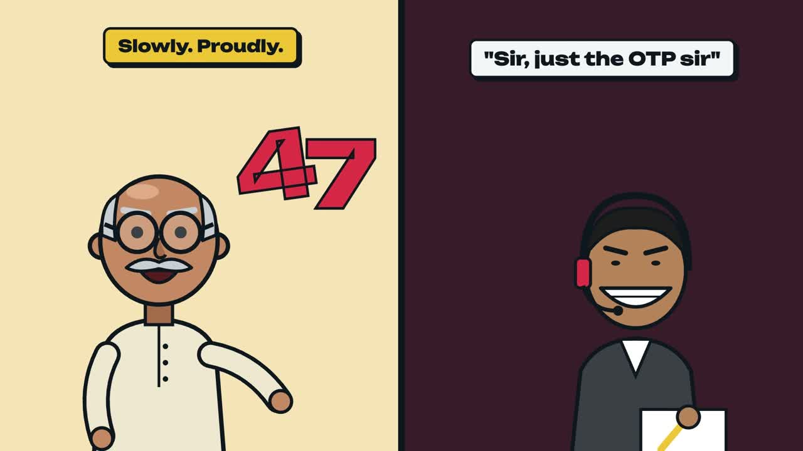

# Demo video

**[Watch / download v1 (2:09, 1920×1080, 20 MB)](https://github.com/zweack/HacktoberFestCyberSafe/releases/download/demo-video-v1/cybersafe-demo-v1.mp4)**: attached to the [`demo-video-v1` release](https://github.com/zweack/HacktoberFestCyberSafe/releases/tag/demo-video-v1) so the repo stays small.

- [`SCRIPT.md`](SCRIPT.md): voiceover with timestamps, for re-recording.
- [`SCENES.md`](SCENES.md): the scene list with visuals and sounds.

Made with Remotion (cinetic skill), Gemini TTS voiceover and code-generated sound effects.
App footage uses real screenshots from `docs/screenshots/`.
