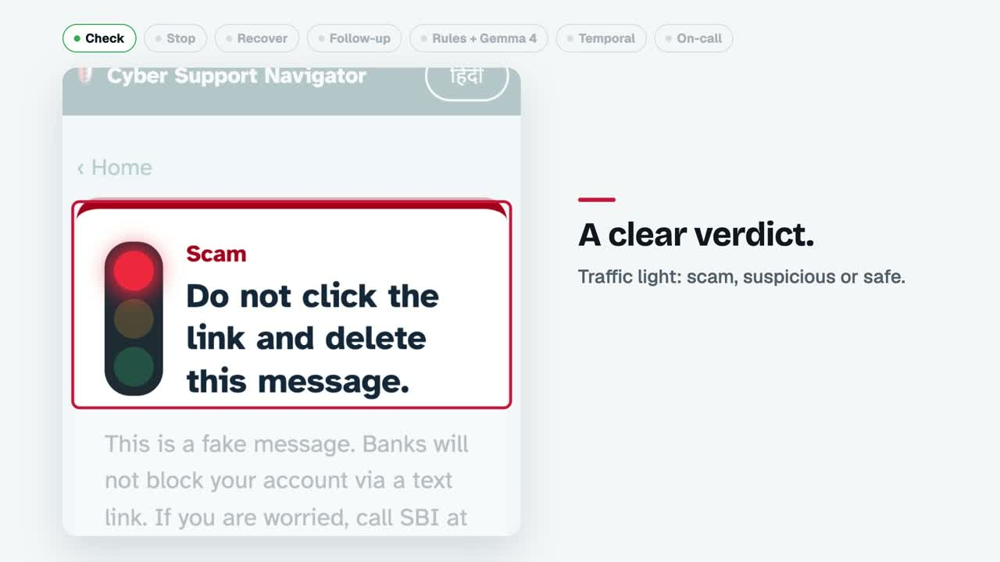
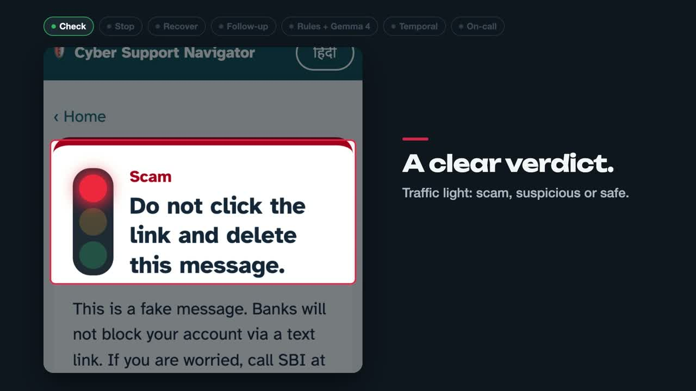

# Demo video

## v3: 90-second explainer, light mode (current)

**[Watch / download v3 (1:30, 1920×1080)](https://github.com/zweack/HacktoberFestCyberSafe/releases/download/demo-video-v3/cybersafe-demo-v3.mp4)**: from the [`demo-video-v3` release](https://github.com/zweack/HacktoberFestCyberSafe/releases/tag/demo-video-v3).
Same narration and flow as v2, in light mode with the kittyleads.com typefaces (Bricolage Grotesque, Geist, Newsreader, Geist Mono).
Script: [`SCRIPT-v2.md`](SCRIPT-v2.md). Visual changes: [`SCENES-v3.md`](SCENES-v3.md).

## v2: 90-second explainer, dark mode

**[Watch / download v2 (1:30, 1920×1080)](https://github.com/zweack/HacktoberFestCyberSafe/releases/download/demo-video-v2/cybersafe-demo-v2.mp4)**: from the [`demo-video-v2` release](https://github.com/zweack/HacktoberFestCyberSafe/releases/tag/demo-video-v2).
A calm explainer with a female voiceover. A focus camera walks through the real app screens (check → stop → recover → follow-up), then the rule engine with Gemma 4 on Jarvislabs, the Temporal workflow, and a real outage drill the on-call team investigates with Kepler.

- [`SCRIPT-v2.md`](SCRIPT-v2.md): voiceover with timestamps, for re-recording.
- [`SCENES-v2.md`](SCENES-v2.md): scene list.

## v1: 2:09 comedy cut

[Watch / download v1](https://github.com/zweack/HacktoberFestCyberSafe/releases/download/demo-video-v1/cybersafe-demo-v1.mp4): cartoon "Sharma ji" story, male voiceover. [`SCRIPT.md`](SCRIPT.md), [`SCENES.md`](SCENES.md).

Videos are attached to GitHub releases so the repo stays small. Made with Remotion (cinetic skill), Gemini TTS and code-generated sound.
